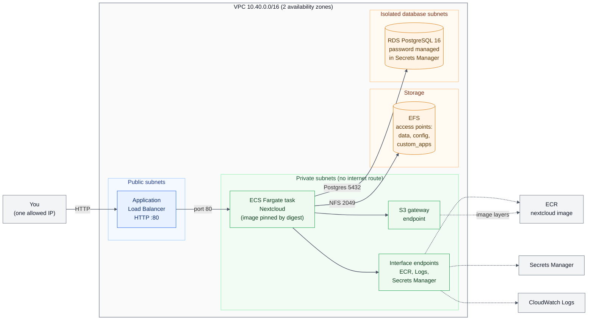

# collab-platform-aws

A self-hosted collaboration platform (Nextcloud, the open-source SharePoint-style option) on AWS, built entirely in Terraform and deployed only through a reviewed pull-request pipeline. Built to be created, tested, documented and destroyed.

Status: design phase.

## Architecture

## Design decisions

1. Reuse, do not copy. Network and database come from the aws-platform-as-code modules, pinned to a commit.
2. Private by default. Tasks have no public IP and no internet route; they reach AWS only through VPC endpoints.
3. Secrets never in code. The database password is created and held by RDS in Secrets Manager.
4. Persistent state on EFS, because Fargate containers are disposable.
5. Lab trade-offs, stated honestly: single task, no Multi-AZ database, HTTP only unless a domain is available.

## Expected problems (what actually happened is in docs/incident-log.md)

- Fargate cannot pull the image from Docker Hub from a private subnet
- Nextcloud rejects requests from the load balancer name until trusted domains are set
- EFS mount denied until the NFS security group rule and access point permissions are right
- Pipeline role lacks EFS permissions on the first apply

## Roadmap

- [x] M1 Design doc
- [x] M2 Storage module (EFS), mirrored image, plan only
- [x] M3 Nextcloud service behind the load balancer, deployed through the pipeline
- [x] M4 Break-and-fix incidents (five real incidents, see docs/incident-log.md)
- [ ] M5 Backups, restore test, alarms (not built: lab stack has no backups, next step)
- [x] M6 Teardown through a PR, evidence (stack destroyed, cost scanner clean)

## Results

- Deployed Nextcloud 35 on ECS Fargate with RDS Postgres and EFS behind an ALB, entirely through Terraform and a plan-on-PR, apply-on-merge pipeline with no stored AWS keys (GitHub OIDC).
- Persistence test: stopped the running task on purpose. ECS started a replacement from a clean container and the admin login and an uploaded PDF were still there.
- Five real incidents found and fixed, each written up with symptom, root cause, fix and lesson in [docs/incident-log.md](docs/incident-log.md).
- Torn down through a PR (56 resources destroyed). The cost scanner from [aws-cost-guardrails](https://github.com/fiehna-hue/aws-cost-guardrails) then reported nothing billable in any region.

## Rebuild it

The teardown commit removed every resource from `envs/collab/main.tf`. To bring the stack back:

1. Mirror the pinned Nextcloud image into a new ECR repository named `nextcloud` (private subnets cannot reach Docker Hub), and check the digest in `main.tf` matches.
2. Revert the teardown commit in a PR, check the plan, and merge. The pipeline applies it.
3. Open the ALB address from the Terraform output and create the admin account in the browser.

Expect about 10 to 15 minutes, and roughly $2 to $3 a day while it runs. Tear it down again the same way.
